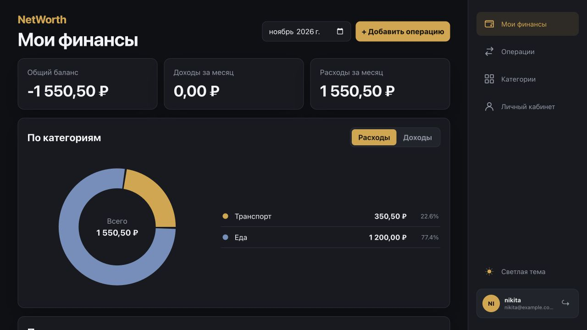
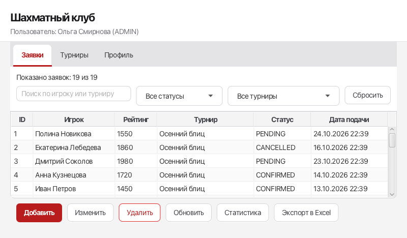
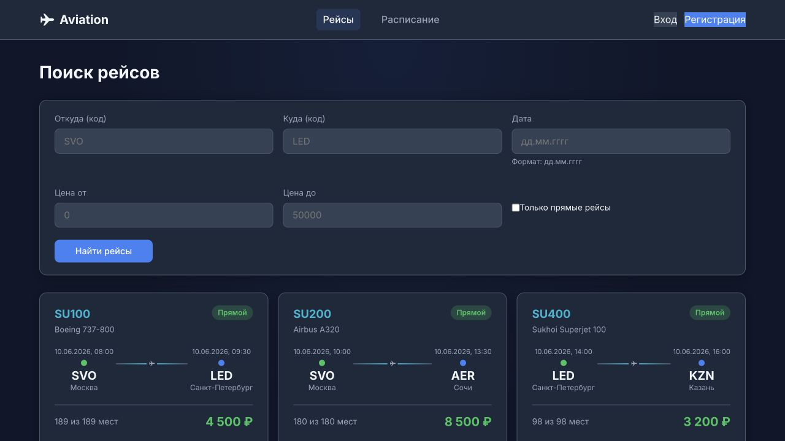
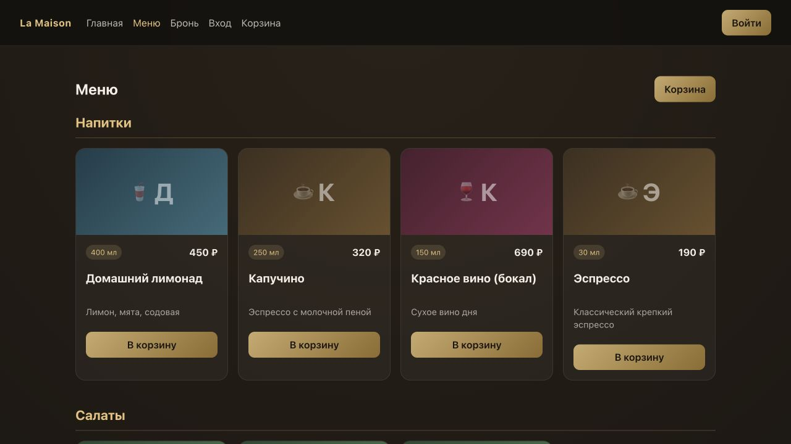

# Привет, я Георгий Ишунин

**Full-stack разработчик · React · Node.js · Python · PostgreSQL**

Разрабатываю приложения целиком: от интерфейса и клиентской логики до REST API, базы данных и развёртывания. Учусь в РТУ МИРЭА и развиваюсь в full-stack разработке, а также работаю с десктопными приложениями, сетями и системным программированием.

В проектах стараюсь уделять внимание не только интерфейсу, но и архитектуре: разделению ролей, бизнес-правилам, работе с данными, тестированию и воспроизводимому запуску.

## Стек

| Направление | Технологии |
|---|---|
| **Frontend** | JavaScript, TypeScript, React, Vue.js, HTML, CSS, Vite |
| **Backend** | Node.js, Express, Python, FastAPI, REST API, Swagger |
| **Данные** | PostgreSQL, SQL, Prisma ORM, JDBC |
| **Другие языки** | Java, C++, C# |
| **Инструменты** | Git, Docker, Linux, CI/CD, Postman, Maven, CMake |

## Избранные проекты

### 01 — [NetWorth](https://github.com/zhorikbla/NetWorth)

**Full-stack · Личные финансы · React + Express + PostgreSQL**

Трекер личных финансов с регистрацией и JWT-авторизацией, доходами и расходами, пользовательскими категориями, месячными лимитами и аналитикой. Реализованы изоляция данных пользователей, административная панель, смена темы, адаптивный интерфейс и Swagger-документация API.

<a href="https://github.com/zhorikbla/NetWorth">
  
</a>

`React 19` · `Express 5` · `PostgreSQL` · `Prisma` · `Recharts` · `JWT` · `Swagger`

---

### 02 — [Шахматный клуб](https://github.com/zhorikbla/chess-club)

**Desktop · Управление турнирами · JavaFX + PostgreSQL**

Десктопное приложение для управления регистрациями игроков на шахматные турниры. Поддерживает роли администратора и игрока, поиск, фильтрацию и сортировку заявок, проверку рейтинга и свободных мест, статистику, историю статусов и экспорт данных в Excel.

<a href="https://github.com/zhorikbla/chess-club">
  
</a>

`Java 21` · `JavaFX` · `FXML` · `JDBC` · `PostgreSQL 17` · `Docker Compose` · `Apache POI`

---

### 03 — [Aviation](https://github.com/zhorikbla/aviatiob_pr)

**Full-stack · Авиаперевозки · React + Express + PostgreSQL**

Система управления рейсами, билетами и пользователями. Есть поиск и расписание рейсов, маршруты с пересадками, просмотр свободных мест, покупка и отмена билетов, личный кабинет и административные разделы для рейсов, пользователей и самолётов.

<a href="https://github.com/zhorikbla/aviatiob_pr">
  
</a>

`React 18` · `Express` · `PostgreSQL` · `JWT` · `Swagger` · `Vite`

---

### 04 — [La Maison — приложение для ресторана](https://github.com/zhorikbla/restaurant-app)

**Full-stack · Заказы и бронирования · React + Express + PostgreSQL**

Веб-приложение для ресторана: меню, корзина, доставка, обслуживание в зале и бронирование столов. Предусмотрены сценарии гостя, клиента и администратора, JWT access/refresh-токены с ротацией, управление меню, столами, заказами, бронями и пользователями, а также журналирование действий администратора.

<a href="https://github.com/zhorikbla/restaurant-app">
  
</a>

`React 19` · `Express 5` · `PostgreSQL` · `JWT` · `Vite`

---

### 05 — [Network Traffic Analyzer](https://github.com/zhorikbla/network_traffic_analyzer)

**Системное программирование · Анализ сетевого трафика · C++**

Консольный сниффер для захвата пакетов через `libpcap`. Поддерживает фильтрацию всего трафика, TCP-пакетов и крупных пакетов, собирает статистику по протоколам и потокам. В архитектуре применены паттерны Strategy, Observer и Singleton; проект собирается CMake и запускается в Docker.

```text
----- statistics -----
packets: 200
bytes: 12800

tcp: 200    udp: 0    icmp: 0    other: 0

----- flows -----
172.17.0.3 -> 172.17.0.4 | packets: 100 | bytes: 5400
172.17.0.4 -> 172.17.0.3 | packets: 100 | bytes: 7400
```

`C++17` · `libpcap` · `CMake` · `Catch2` · `Docker`

## Контакты

- GitHub: [github.com/zhorikbla](https://github.com/zhorikbla)
- Email: [georgiishunin31@mail.ru](mailto:georgiishunin31@mail.ru)

